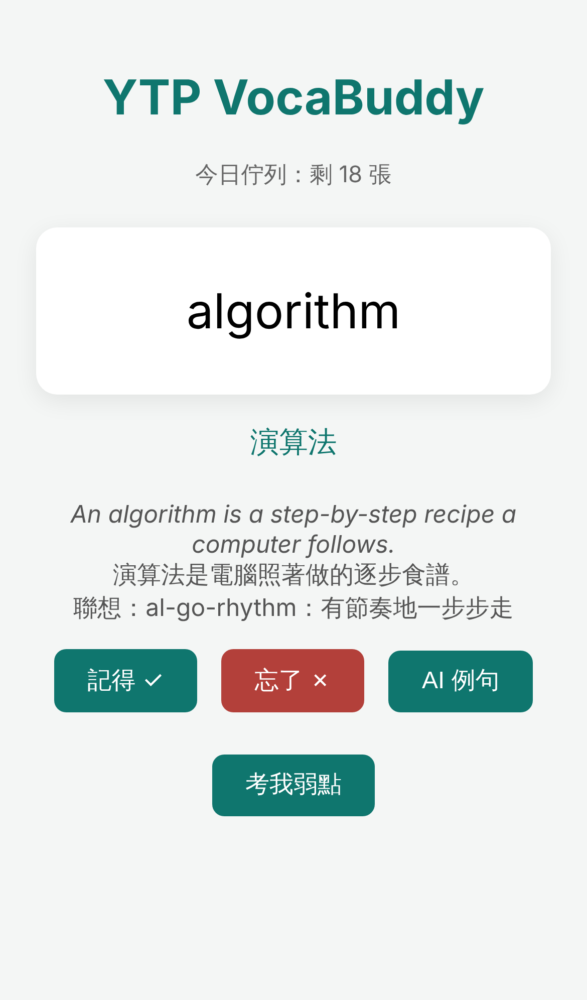
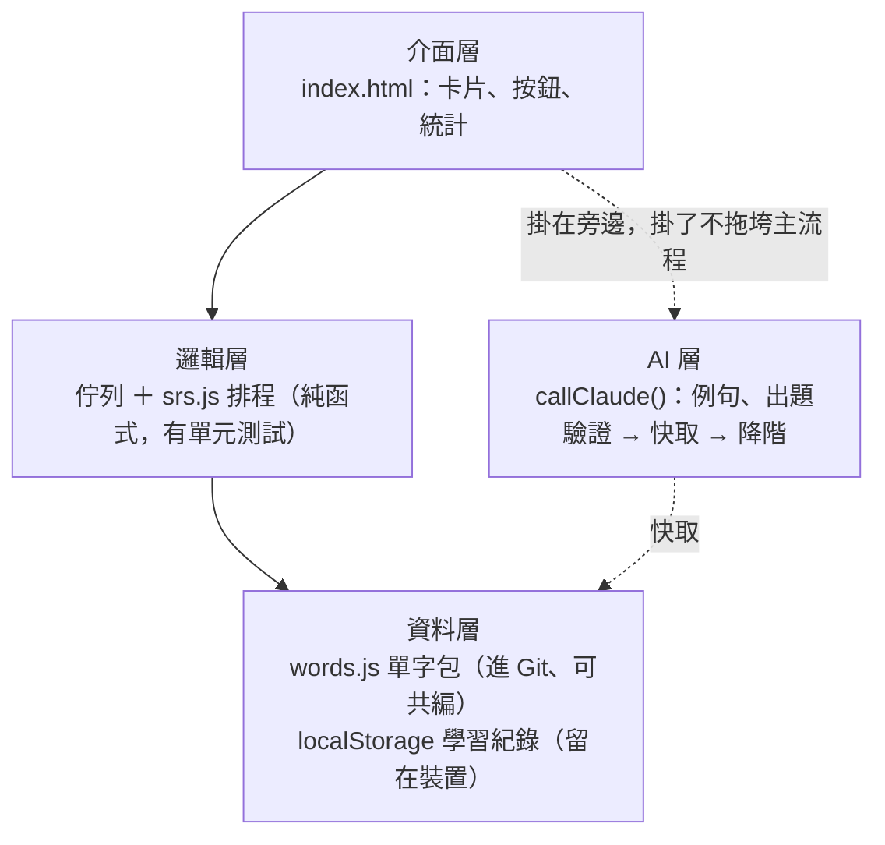

# YTP VocaBuddy

[](https://github.com/ytp26h2/ytp26h2-labs/actions/workflows/ci.yml)

**用 AI 與間隔重複演算法，讓背單字有效率——手機、平板、電腦通用。**

## Live Demo

**<https://ytp26h2.github.io/ytp26h2-labs/labs/lab10-graduation/>**（手機瀏覽器選單 → 加入主畫面，就是一個可離線的 App）



## 功能

- **SRS 排程**：Leitner 五盒，答對晉級、答錯打回盒 1；只複習今天到期的卡，記得的字不再浪費時間。
- **AI 例句**：翻面後一鍵生成 CEFR B1 例句、中譯與聯想，結果有驗證（例句必含目標字）、有快取（同字不再花錢）、有降階（失敗時不影響複習）。
- **弱點出題**：從學習紀錄找出錯誤率最高的三個字，餵給模型出四選一克漏字，答題結果再寫回紀錄，形成閉環。
- **離線可用**：PWA，service worker 快取整個 App；飛航模式照常複習，AI 例句顯示快取或友善訊息。
- **自帶金鑰（BYOK）**：API key 只存在你自己的瀏覽器，前端沒有任何祕密。
- **單字包匯入**（畢業挑戰，開發中，見 [issue #30](https://github.com/ytp26h2/ytp26h2-labs/issues/30)）：貼上 `en,zh` CSV 即可擴充自訂單字，含格式驗證。

## 技術與架構

純前端，零框架、零建置：一個 `index.html` 加三支小檔案。四層各自能單獨動刀。



| 層 | 檔案 | 說明 |
|---|---|---|
| 介面 | `index.html` | 看卡 → 回想 → 翻面 → 自評 → 下一張的核心迴路 |
| 邏輯 | `srs.js`、`test_srs.js` | `schedule(box, ok, today)` 不看時鐘的純函式，Node 直接測 |
| AI | `index.html` 的 `callClaude()` | 瀏覽器直呼 Claude API（`claude-sonnet-5-5`），Structured Output 只收 JSON |
| 資料 | `words.js`、`check_words.js`、localStorage | 單字包進 Git 供全隊共編並由 CI 檢查；學習紀錄只在裝置 |
| 上線 | `manifest.json`、`sw.js`、`.github/workflows/ci.yml` | GitHub Pages 部署、PWA 離線、每個 PR 自動跑測試 |

**隱私設計**：學習紀錄與 API key 都只存在使用者自己的 localStorage，不回傳任何伺服器；App 本身沒有後端。

## 本地執行

```sh
git clone https://github.com/ytp26h2/ytp26h2-labs.git && cd ytp26h2-labs/labs/lab10-graduation
python3 -m http.server 8000        # service worker 需要 http，file:// 不行
node test_srs.js && node check_words.js
```

然後開 <http://localhost:8000/>。

## Roadmap

- **單字包 CSV 匯入**（進行中）：貼上即匯入、逐行驗證、離線可用。
- **SM-2 排程**：把 Leitner 換成帶容易度係數的 SM-2，測試先行。
- **語音發音**：Web Speech API 讓卡片開口說話。
- **學習統計頁**：用 SVG 畫出自己的遺忘曲線與答對率趨勢。
- **自建代理**：把 API key 收進伺服器端，走完安全階梯最後一階。

## 作者與分工

| 誰 | 做了什麼 |
|---|---|
| [YTP2026H2 主辦](https://github.com/tw-ytp)（[ytp26h2](https://github.com/ytp26h2)） | 每個 Lab 的 Plan 確認、合併 PR 與建 Release、GitHub Pages 設定、手機真機實測、Demo 排練 |
| Claude（Claude Code） | 依教材實作各 Lab、撰寫測試與驗收腳本、整理文件與勘誤 |

全程透過 Claude 在瀏覽器中完成，程式碼與文件直接進 GitHub；教材：[YTP VocaBuddy 開發者之路](https://tw-ytp.github.io/vocabuddy/) v2.0。

---

## Lab 10 指引（教材對照）

> 教材：<https://tw-ytp.github.io/vocabuddy/#/lab10>（v2.0），內容照 4.5 與 Lab 10 頁
> 目標：作品級 README、一場排練過的 3 分鐘 Demo、一個獨立完成的畢業挑戰
> 時間：README＋Demo 約 90 分鐘；畢業挑戰另計｜前置：完成 Lab 9
> 檢查點 tag：`v1.1`（`v1.0` 已在 Lab 9 建立）

| 教材步驟 | 教材要你做 | 本 repo 實際發生的事 |
|---|---|---|
| README 作品化 | 照 4.5 七段結構重寫 README，走分支與 PR（docs:） | 本檔前半就是作品級 README；issue [#29](https://github.com/ytp26h2/ytp26h2-labs/issues/29)、分支 `lab10/docs/readme`。截圖先以無頭 Chromium 的 iPhone 視口產生，可換真機安裝後的畫面。 |
| 寫 Demo 腳本、計時排練 | 逐字稿、排練三次、錄第三次當備援 | 逐字稿在 [`DEMO.md`](DEMO.md)；排練與錄影由主辦做，結果記在 `CHECKLIST.md`。 |
| 互相 Demo | 隊友當評審問三個問題 | 三個問題列在 `DEMO.md` 末尾，供主辦與學員使用。 |
| 畢業挑戰 | 選題、開 issue 寫驗收條件、整條流程獨走、自評尺規 | 選「單字包 CSV 匯入」；issue [#30](https://github.com/ytp26h2/ytp26h2-labs/issues/30)、分支 `lab10/feature/csv-import`；自評寫在 issue 結案留言。 |

驗收清單見 `CHECKLIST.md`。教材原始五項：

1. README 首屏就有：一句話定位、Live 網址、截圖、CI 徽章
2. 3 分鐘 Demo 排練三次以上，有 90 秒備援影片在手機裡
3. Demo 用的單字已快取預熱，斷網也能完整演示
4. 畢業挑戰的 PR 已合併、已上線、自評尺規四個面向都誠實打過分
5. 回頭看 Lab 1 的第一個 commit——你能說出這一路每個 tag 各代表什麼

Plan（已確認）同步寫在 `index.html` 頂端註解，共 6 步。
